# Hyper-VによるWindows Server 2022構築

## 概要

Windows 11 PCに Hyper-V を導入し、Windows Server 2022 の仮想マシンを構築する。

---

## 1. Windows Server 2022 ISOイメージのダウンロード

Microsoft 評価センターの「無料で使用開始 - ISO のダウンロード」から必要事項を入力し、ISOイメージをダウンロードして保存する。
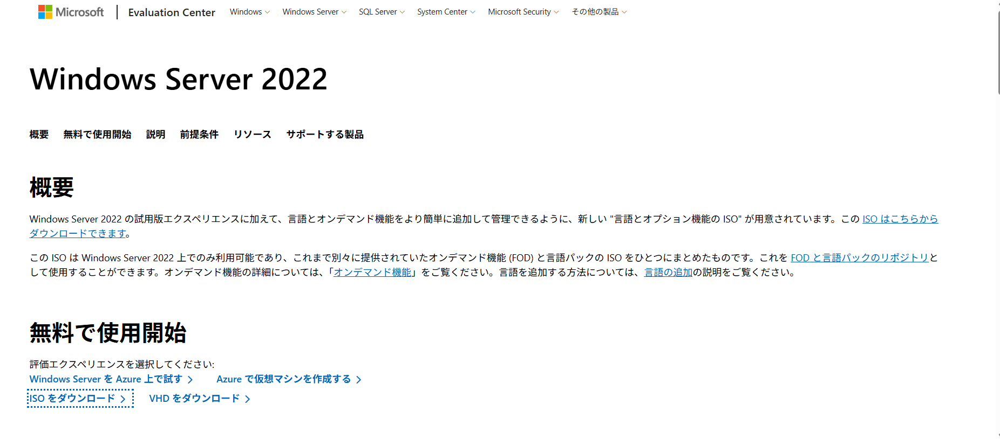
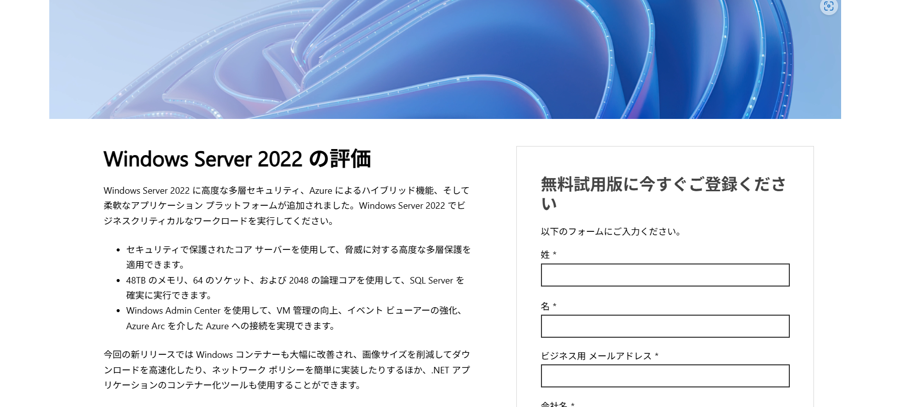
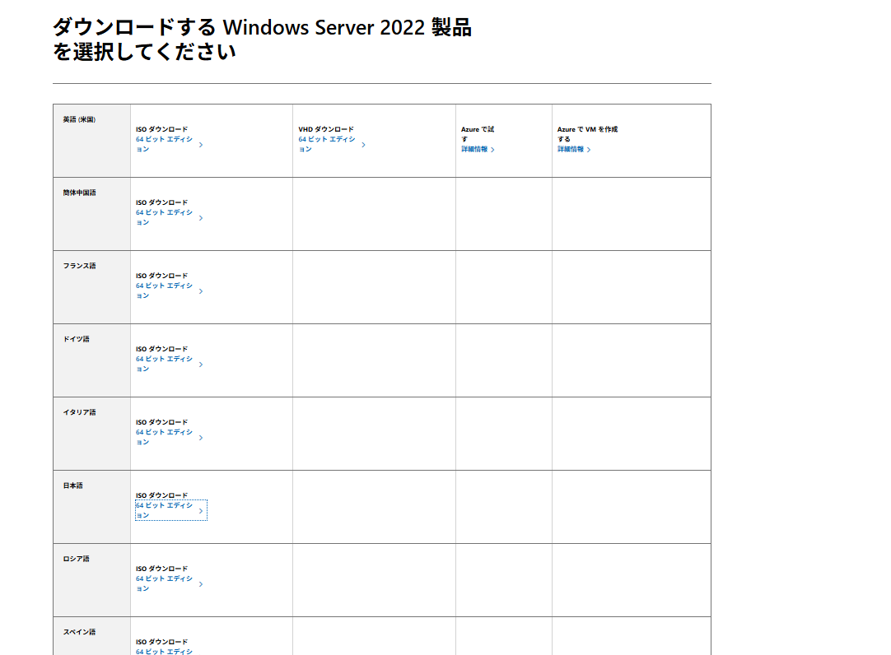

### 参考

- [Windows および Windows Server に Hyper-V をインストールする | Microsoft Learn](https://learn.microsoft.com/ja-jp/windows-server/virtualization/hyper-v/get-started/install-hyper-v?source=recommendations&tabs=powershell&pivots=windows)

---

## 2. Hyper-Vの有効化

[ スタート ] ボタンを選択し、[ コントロールパネル ] > [ プログラム ] > [ Windowsの機能の有効化または無効化 ]からHyper-Vを有効化をしパソコンを再起動する。
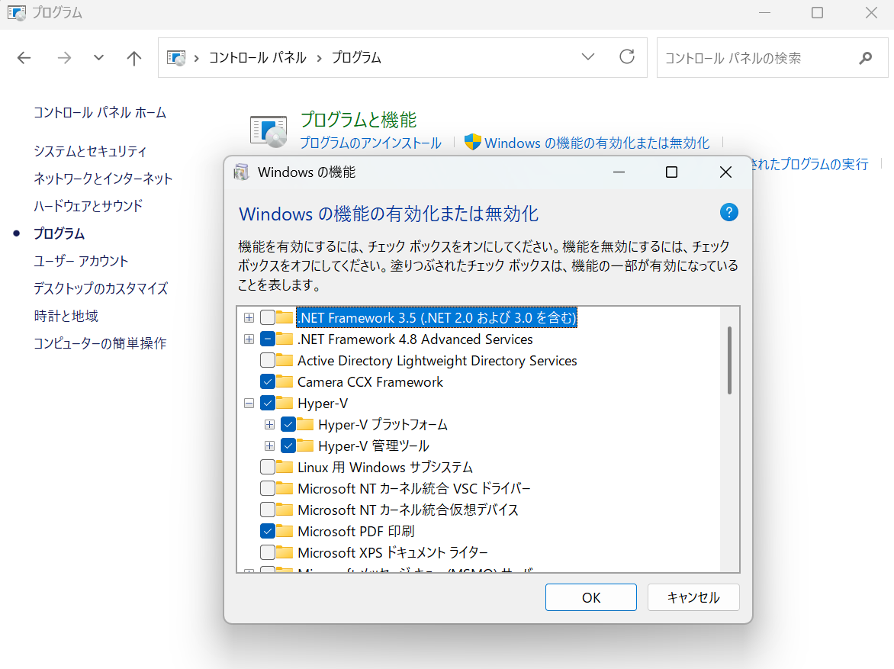

### 参考

- [Windows および Windows Server に Hyper-V をインストールする | Microsoft Learn](https://learn.microsoft.com/ja-jp/windows-server/virtualization/hyper-v/get-started/install-hyper-v?source=recommendations&tabs=powershell&pivots=windows)

---

## 3. 仮想マシンの作成

[ Hyper-V マネージャー ] を起動し、左側のウィンドウの[ Hyper-V マネージャー ] サーバーを選択し、右側の[ 操作 ] ウィンドウで [ 新規 ] > [ 仮想マシン ] を選択する。
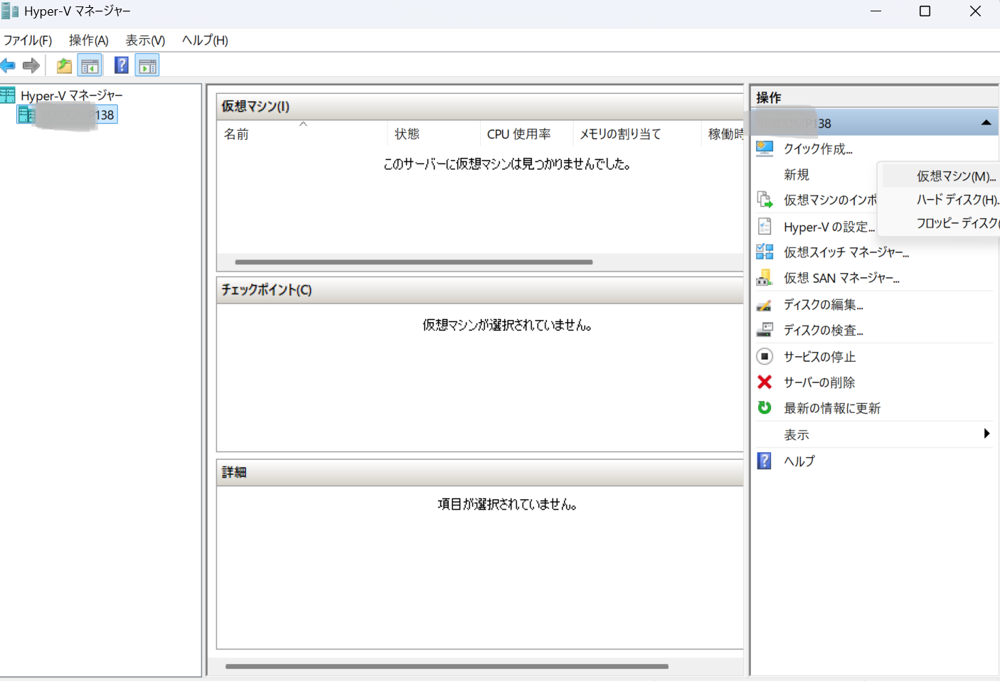

---

## 4. 仮想マシンの新規作成ウィザード

仮想マシンの新規作成ウィザードで、[ 次へ ]を選択する。
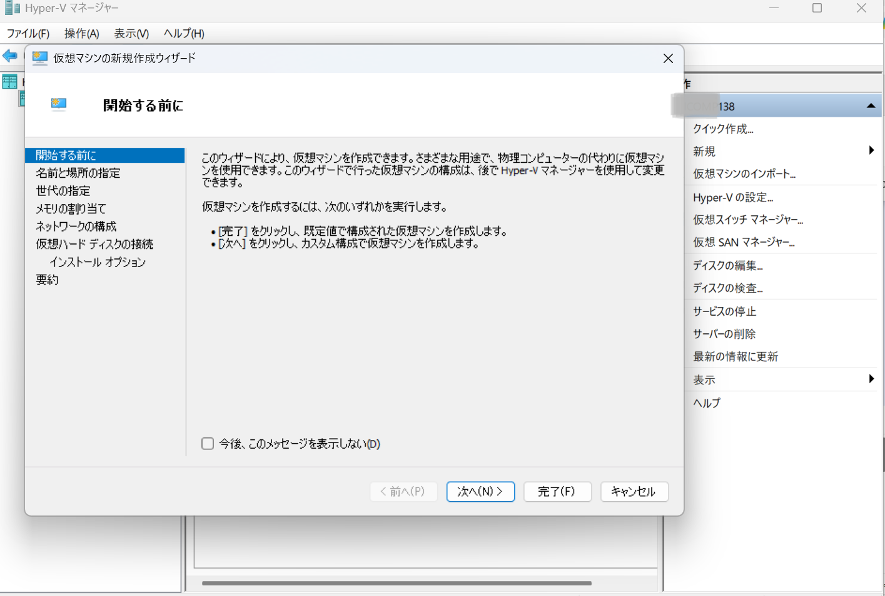

---

## 5. 名前と場所の指定

[ 名前と場所の指定 ] ページで、仮想マシンの名前[ Demo2026.10.20 ]を入力し、仮想マシン構成ファイルを格納する場所[ C:\ProgramData\Microsoft\Windows\Hyper-V\（規定値のまま） ]を選択し、 [ 次へ ] を選択する。
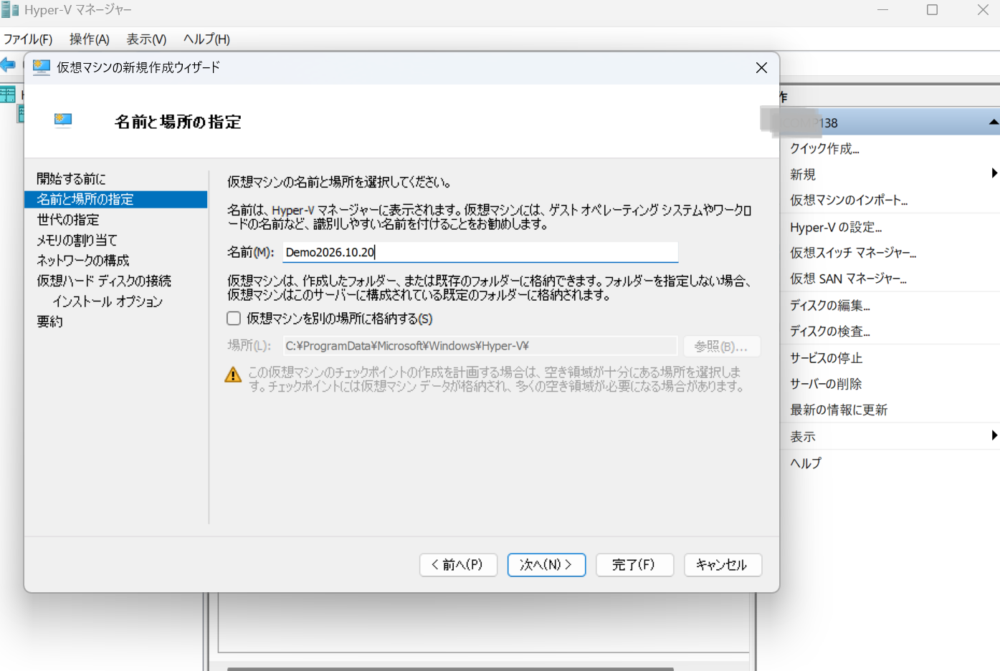

---

## 6. 世代の指定

[ 世代の指定 ] ページで、仮想マシンの世代[ 第 2 世代(2) ] を選択する。 第 1 世代仮想マシンを作成する特定の理由がない限り、第 2 世代仮想マシンを作成し、 [次へ] を選択する。
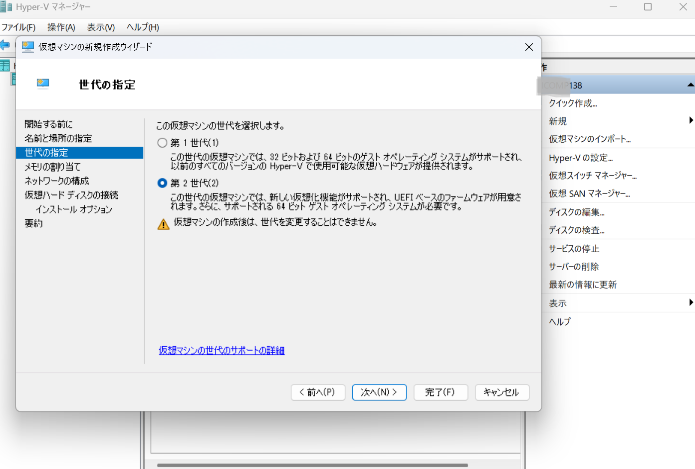

### 参考

- [Hyper-V で第 1 世代または第 2 世代の仮想マシンを作成する必要がありますか | Microsoft Learn](https://learn.microsoft.com/ja-jp/windows-server/virtualization/hyper-v/plan/should-i-create-a-generation-1-or-2-virtual-machine-in-hyper-v)

---

## 7. メモリの割り当て

[ メモリの割り当て ] ページで、起動時に仮想マシンに割り当てるメモリの量[ 4,096 MB（規定値のまま） ] を入力する。 動的メモリを有効にすることもできる。 [ 次へ ] を選択する。
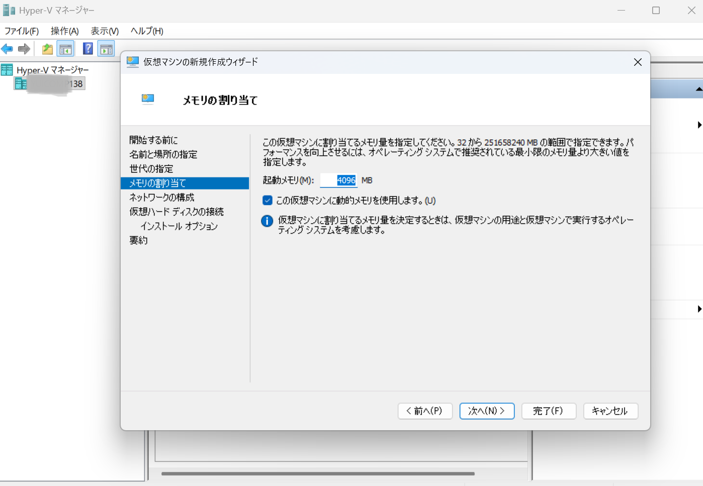

### 参考

- [Hyper-V 仮想マシンの動的メモリ | Microsoft Learn](https://learn.microsoft.com/ja-jp/windows-server/virtualization/hyper-v/dynamic-memory)

---

## 8. ネットワークの構成

[ ネットワークの構成 ] ページで、接続方法のプルダウンから[ Default Switch ]を選択する。 仮想スイッチを作成していない場合は、この手順をスキップし、後でネットワークを構成できる。 [次へ] を選択する。
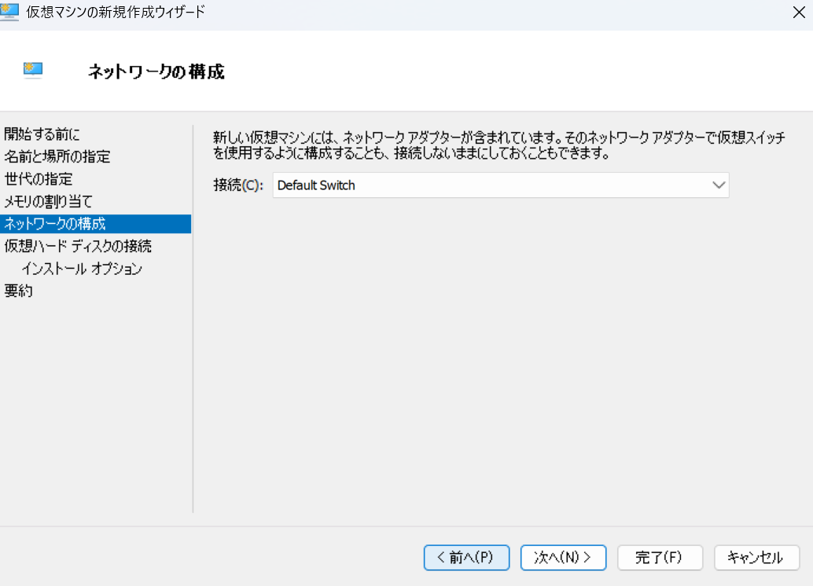

---

## 9. 仮想ハードディスクの作成

[ 仮想ハード ディスクの接続 ] ページで、[ 仮想ハード ディスクを作成する ] - 仮想ハード ディスク の名前を確認し、保存する場所を選択して、そのサイズ[ 40GB ] を指定し、[ 次へ] を選択する。
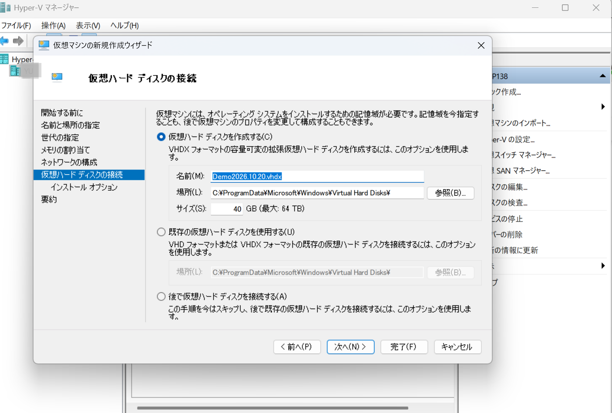

---

### サイズ検討

仮想ハードディスクの容量を検討するため、以下の資料を参考にした。

- Windows Server の概要や設定の基礎、Active Directory の基礎を学習できる講座（推奨容量：約30GB）
  - [【基礎Ⅰ】まるっと学べるWindows Server -Windows Serverの設定ができるようになる- | Udemy Business](https://shikoku-itjp.udemy.com/course/windowsserver/learn/lecture/33855994#overview)

- Hyper-V で Windows 仮想マシンを構築した事例（推奨容量：約50GB）
  - [【Hyper-V】 Hyper-V で仮想マシンを構築してみた #Windows11 - Qiita](https://qiita.com/7mountain/items/9decc8db92740ca47a3f)

- Hyper-V の仮想マシン作成方法（推奨容量：約60GB～127GB）
  - [【Windows】Hyper-Vで仮想マシン（VM）を作成する方法](https://partition.aomei.jp/articles/create-a-virtual-machine-with-hyper-v-7868-gc.html)

- Microsoft Learn
  - [Hyper-V で仮想マシンを作成する | Microsoft Learn](https://learn.microsoft.com/ja-jp/windows-server/virtualization/hyper-v/get-started/create-a-virtual-machine-in-hyper-v?source=recommendations&tabs=hyper-v-manager)

### 検討結果

各資料で推奨容量に差があったが、今回の検証では 40GB を選択した。

---

## 10. インストールオプション

[ インストール オプション] ページで、[ 起動可能なイメージ ファイルからオペレーティング システムをインストール する - オペレーティング システムのインストール メディアを含む .iso ファイルの場所を参照します ] を選択し、[ 次へ ] を選択する。
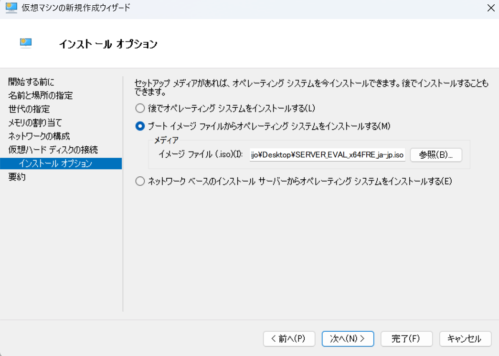

---

## 11. 概要
[概要] ページで選択内容を確認したら、[完了] を選択する。
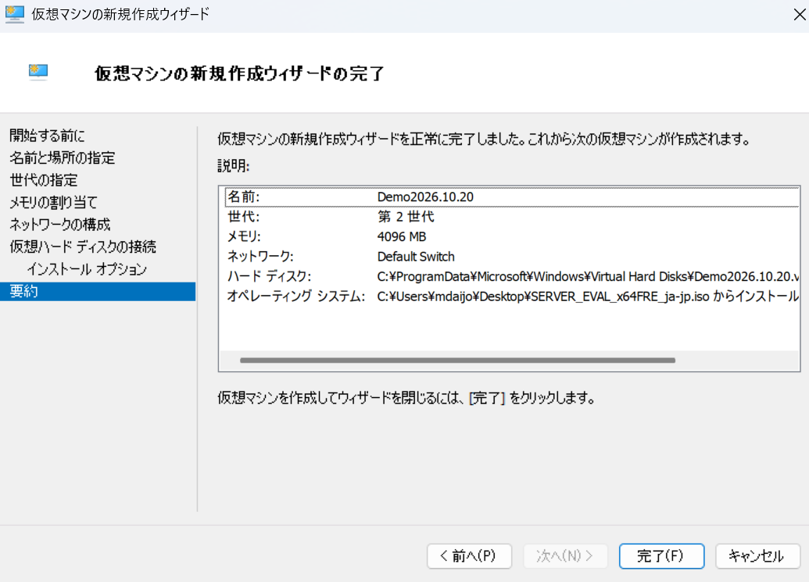

---

## 12. 構築完了
[ Hyper-V マネージャー ]にWindowsServerの構築が完了した。
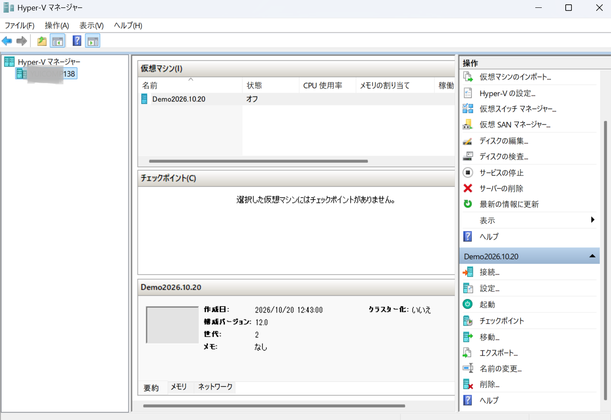

---

# 発生した問題

## 事象

[ Hyper-V マネージャー ]で [ Windows Server 2022仮想マシン ]が起動できない。
起動して、接続したところ、次の画面が出て起動しない。
エラーメッセージ「The boot loader failed」
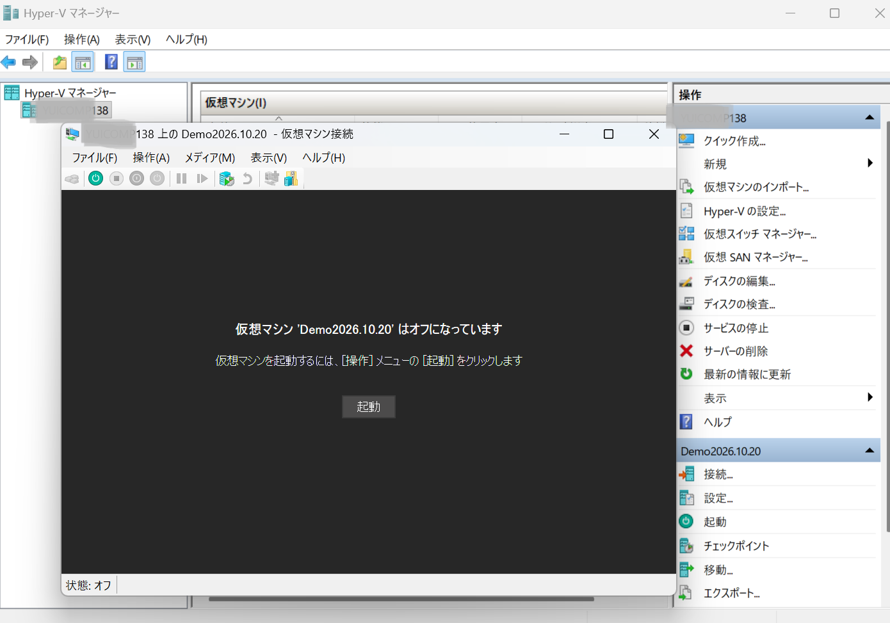
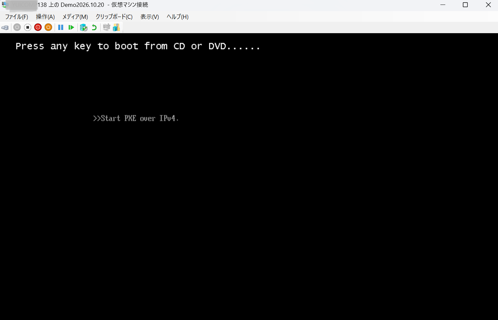
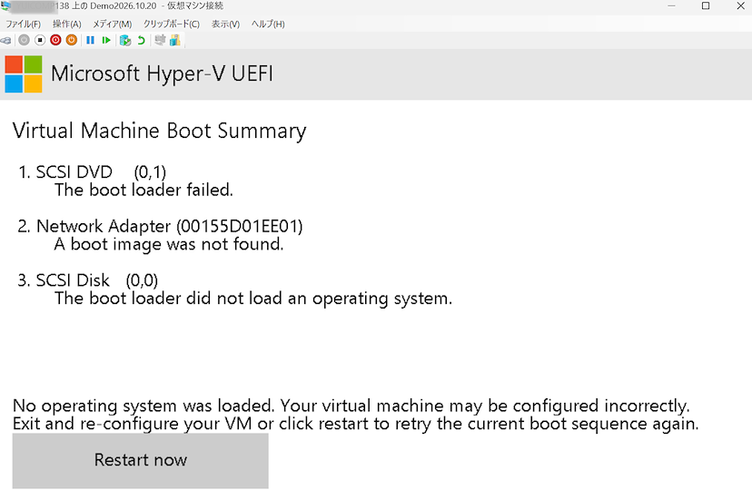

---

## 原因

ISOから起動する際、「Press any key to boot from CD or DVD...」の表示中にキーを押していなかった！

---

## 解決策

「Press any key to boot from CD or DVD......」の最後の点が6つ出る前に何らかのキーを押す。急いで押す。
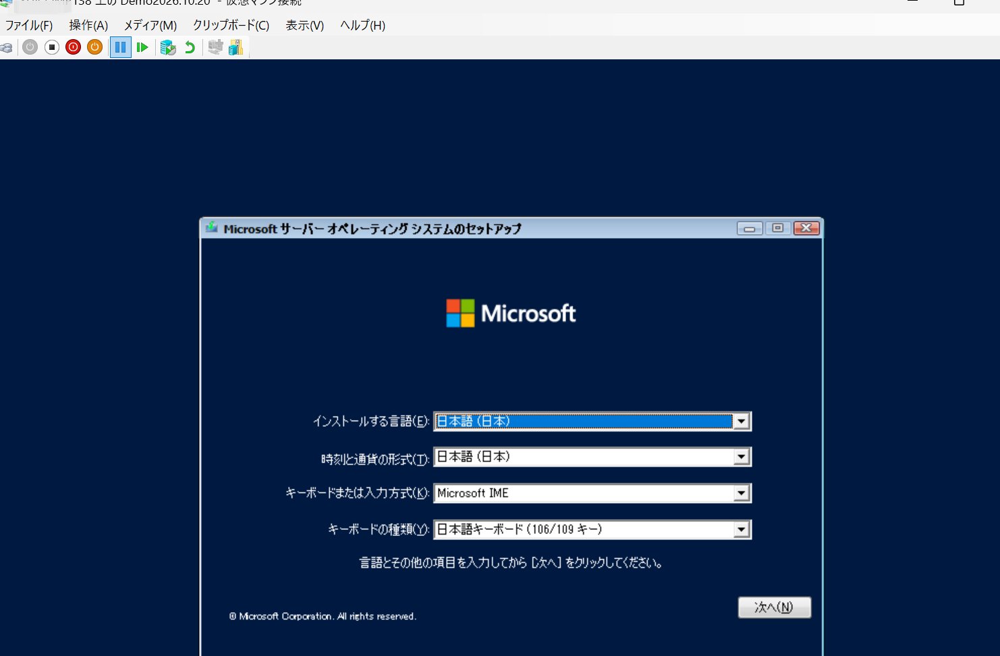

---

### 参照

- [Hyper-Vにて、Windows10の仮想マシンを第2世代で構築しようとしたらハマった話 #Windows10 - Qiita](https://qiita.com/saeki4n/items/b712cd5c9359f3b54dae)

- [Hyper-V環境でWindowsをインストールしたときに、No operating systemと表示されてしまう問題解決 - Archived Masami Suzuki Blog](https://shima.suzuki-jpn.com/2021/02/10/883/)

- [Hyper-V VMでブートローダーが読み込まれませんでした - Microsoft Q&A](https://learn.microsoft.com/en-us/answers/questions/5548959/boot-loader-did-not-load-in-hyper-v-vm)

---

# 学んだこと

- Hyper-V を利用して仮想環境を構築できる。
- Windows Server 2022 を ISO からインストールできる。
- Default Switch を利用してネットワーク接続できる。
- ブートエラー発生時の確認ポイントを理解できた。
