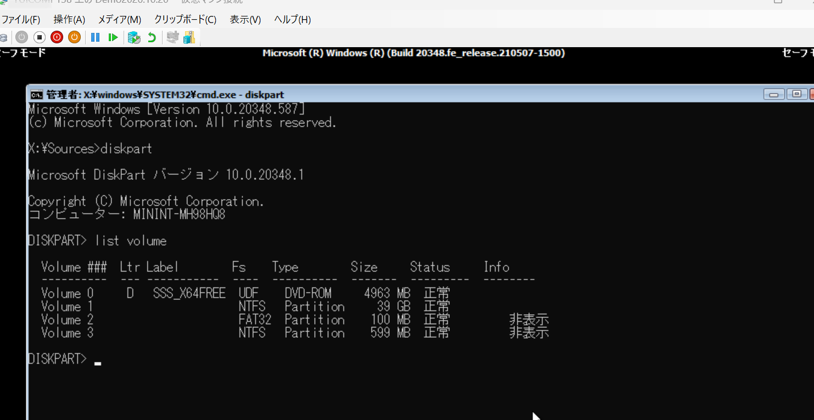
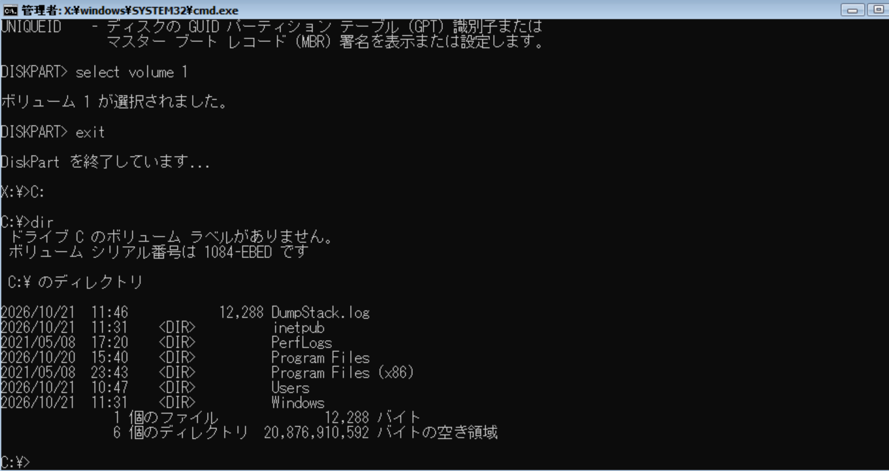
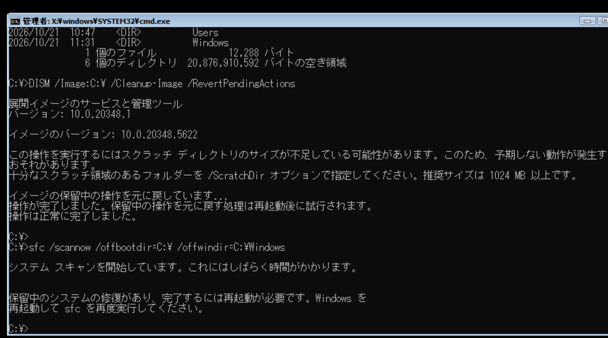
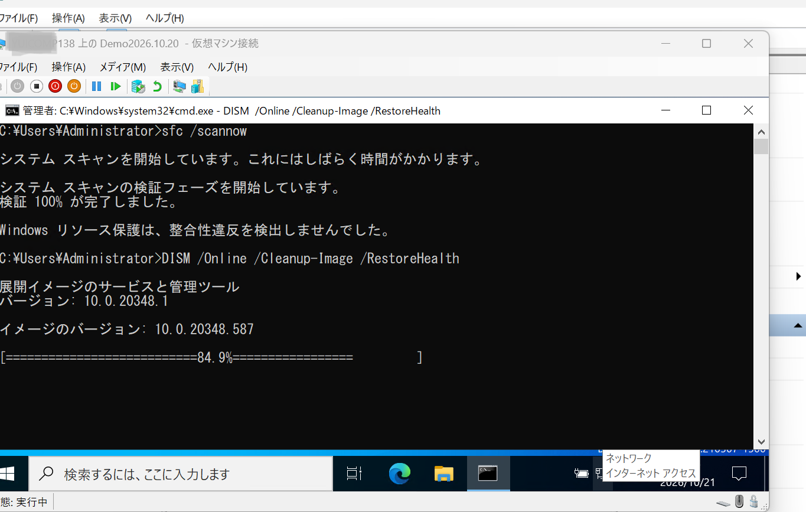
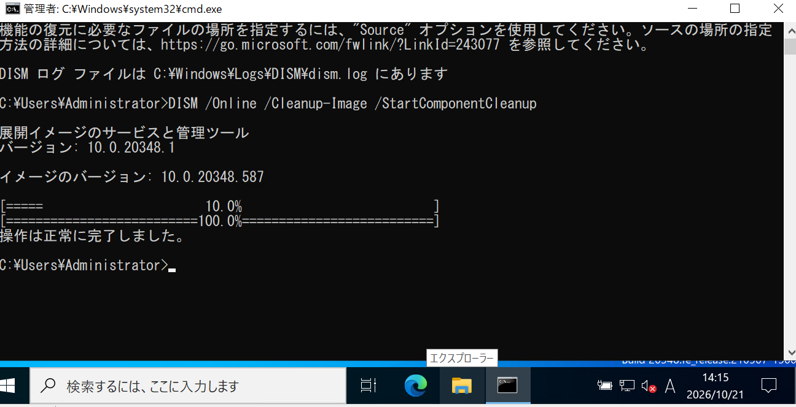
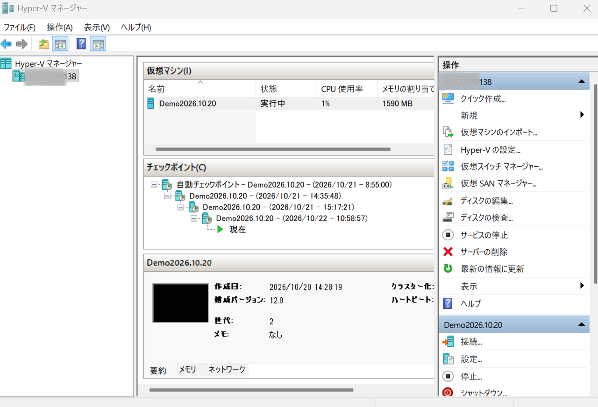
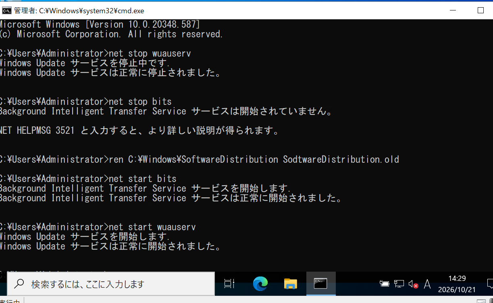
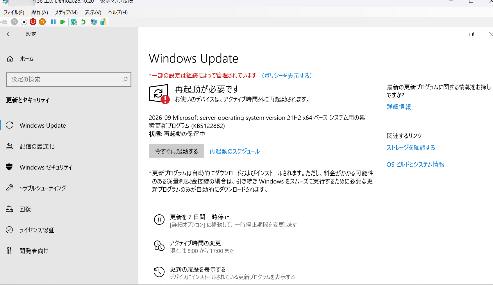
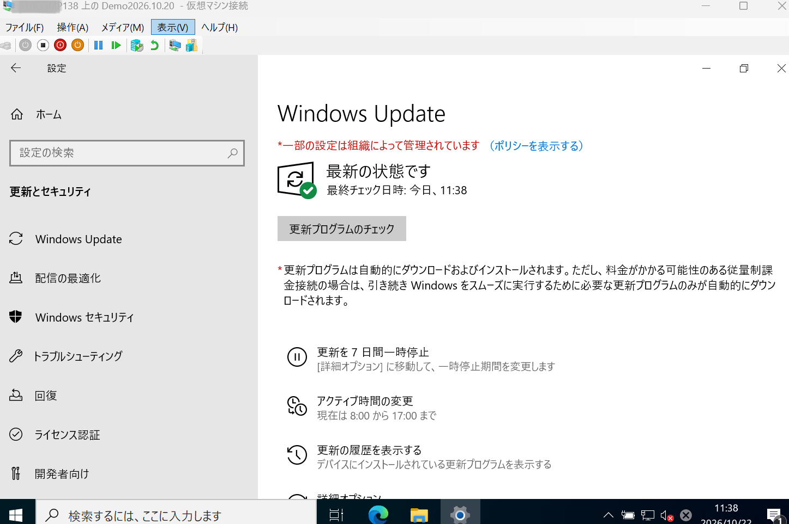

# Windows Server 2022 Update

## 概要

Windows Update 実施後に 0xc000021A が発生し、OS が起動不能となった。

WinRE から DISM を利用して更新プログラムをロールバックし、
Windows Server 2022 の復旧および KB5122882 の適用成功までを記録する。

## 実施内容

- Windows Update 実施
- KB5122882 適用
- 0xc000021A 発生
- WinRE DISMによる復旧
- Windows Update キャッシュ再構築
- KB5122882 適用成功

---

## 環境

```text
ホストOS
Windows 11

仮想化基盤
Hyper-V

ゲストOS
Windows Server 2022 Evaluation

対象更新プログラム
KB5122882
```

## お困りの事象

### 事象

Windows Update の更新プログラムのインストールに失敗した。

#### エラーメッセージ

```text
0xc000021A
```

Copilot 曰く、

> Windows の重要なシステムプロセス（Winlogon.exe や CSRSS.exe など）が異常終了したときに発生する停止エラー。

### 参考

- [バグチェック 0xC000021A WINLOGON_FATAL_ERROR - Microsoft Learn](https://learn.microsoft.com/ja-jp/windows-hardware/drivers/debugger/bug-check-0xc000021a--winlogin-fatal-error)

---

## 解決策

### ① Windows ドライブを確認する。

```cmd
diskpart
list volume
```

Volume 1 = 39GB (Windowsっぽい)


---

### ② Volume 1 にドライブ文字を割り当てる。

```cmd
select volume 1
assign letter=C
exit
```

確認する。

```cmd
C:
dir
```


### ③ 更新プログラムの取り消してロールバックする。

### 参考

- [Windows イメージの修復 | Microsoft Learn](https://learn.microsoft.com/ja-jp/windows-hardware/manufacture/desktop/repair-a-windows-image?view=windows-11)

```cmd
DISM /Image:C:\ /Cleanup-Image /RevertPendingActions
sfc /scannow /offbootdir=C:\ /offwindir=C:\Windows
```


再起動する。（DVD ではなく仮想ディスク（Windows Server）から起動する。）
```cmd
wpeutil reboot
```

---

### ④ 管理者権限の [ コマンド プロンプト ]で実行し、修復する。

```cmd
sfc /scannow
DISM /Online /Cleanup-Image /RestoreHealth
DISM /Online /Cleanup-Image /StartComponentCleanup
```



### 参考

- [DISM /Online /Cleanup-Image /RestoreHealthの使い方と注意点｜Windows修復の決定版 #Tenorshare4DDiG - Qiita](https://qiita.com/Tenorshare_4DDiG/items/a4dbad1b18124c24a22f)

---

### ⑤ 修復後、仮想マシンで右クリックしチェックポイントを作成する。



---

### ⑥ Windows Updateのキャッシュをリセットし、再起動する。

```cmd
net stop wuauserv
net stop bits
ren C:\Windows\SoftwareDistribution SoftwareDistribution.old
net start wuauserv
net start bits
shutdown /r /t 0
```


---

### ⑦ Windows Updateを再実行し、再起動する。（[ コマンド プロンプト ]では\が¥表示になる模様）



---

## 学んだこと

- Windows Update が失敗すると OS が起動不能になる場合がある。
- WinRE（Windows 回復環境）から DISM を実行し、更新プログラムをロールバックできることを学んだ。
- Windows Update キャッシュをリセットする方法を学んだ。
- Hyper-V のチェックポイントが障害対応に有効であることを理解できた。
- エラーコード 0xc000021A の調査から復旧までを一通り経験できた。
- 更新プログラム KB5122882 の適用失敗と再適用を通じて Windows Server の運用保守を学習できた。

